# zmk-config-velvet

## Velvet36 (`36-trackball`)

The compiled keymap mirrors the updated DYA Studio layout captured on 2026-11-05:
BASE, SYMBOL, NUMBER, MOUSE, and four transparent spare layers. A/D/F use
**Optimized Mod-Tap** (`opt_mt`, 280 ms tapping term) for Ctrl/GUI/Alt; S/L use
**More Sensitive Optimized Mod-Tap** (`opt_mt_2`, 200 ms) for Shift. Both retain
the Corne's balanced flavor, 175 ms quick tap, and 150 ms prior idle.
The layout includes Ctrl+B at BASE position 12, Home/End on SYMBOL, and the
updated MOUSE button positions. The MOUSE encoder inherits BASE's volume controls.

Mouse movement retains Studio's **39/200** (0.195x) sensitivity and activates
MOUSE (layer 3), with a 100 ms guard after typing and a 700 ms inactivity timeout.
Holding SYMBOL (layer 1) selects high-resolution scrolling with gentle momentum.
Scroll scaling is **4/15** in units of 1/16 wheel step, preserving the earlier
**1/60** wheel-step sensitivity. Hosts that do not enable high resolution get
normal wheel increments at the same rate. Both profiles retain Studio's vertical
axis snapping (threshold 100, window 1000 ms).

Momentum uses a 200 ms measurement window, 20 ms ticks, 15% decay per tick, and
a one-wheel-step-per-tick cap, with no fast-stage boost. It stops when SYMBOL is
released. A small compatibility module converts physical scrolling and momentum
at the same HID boundary; its checked source patches and dependency pins avoid
the upstream fallback-scaling bug. Mouse movement reports are unchanged.

See [flashing and adopting the compiled defaults](docs/flashing.md). Saved
Studio overrides survive flashing, so use the documented selective resets
when adopting this layout for the first time.

## 改键客户端
https://github.com/cormoran/dya-studio/releases

## 网页改键
https://studio.dya.cormoran.works/

_(keymap image generated by [caksoylar/keymap-drawer](https://github.com/caksoylar/keymap-drawer))_

